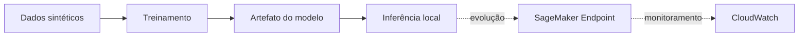

# AWS MLOps | Treinamento e inferência

Exemplo reproduzível de classificação com execução local e estrutura para futura implantação na AWS.

**Serviços previstos:** Amazon SageMaker, ECR, CloudWatch, Lambda e API Gateway. Esta versão ainda não foi implantada na nuvem.

## Fluxo



## Executar

```bash
pip install -r requirements.txt
python src/train.py
python src/predict.py
```

Os scripts usam dados sintéticos do scikit-learn, imprimem métricas calculadas na execução e salvam o modelo em `artifacts/`, pasta ignorada pelo Git.

## Próximas etapas

- Empacotar inferência em contêiner e publicar no ECR.
- Registrar o modelo e implantar endpoint no SageMaker.
- Monitorar logs e métricas no CloudWatch.
- Testar variantes de implantação.

**Escopo:** demonstração independente, sem credenciais, identificadores de conta ou materiais internos de avaliações AWS.
